<div align="center">


# PRISM

### Policy Rule Interpretation and Socioeconomic Impact Modelling

**A legal-intelligence platform that treats a statute as a program: it reads the law clause by clause, ties every number to the words it came from, executes the law on the population it governs, and checks the reading against the law itself.**

[](https://github.com/febinrenu/PRISM/actions/workflows/deploy.yml)
[](LICENSE)


**[Live demo](https://prism-law.vercel.app)** ·
[Product tour](#product-tour) ·
[Architecture](#architecture) ·
[Subsystems](#subsystems) ·
[Results](#measured-results) ·
[Public API](#public-api) ·
[Security](#security-model) ·
[Run it](#getting-started) ·
[Hosted demo](#hosted-demo) ·
[Licence](#ownership-and-licence)

<br />

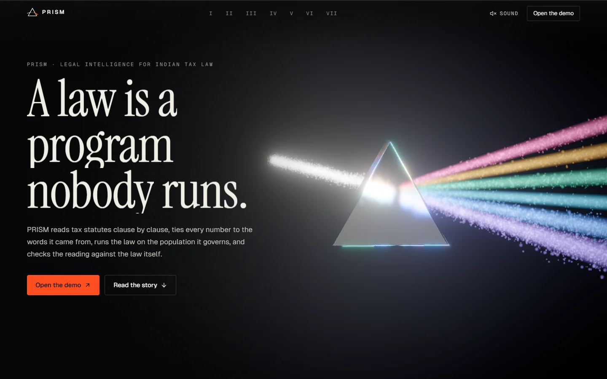

</div>

---

## Contents

1. [Why PRISM exists](#why-prism-exists)
2. [What it does](#what-it-does)
3. [Product tour](#product-tour)
4. [Architecture](#architecture)
5. [Subsystems](#subsystems)
6. [Measured results](#measured-results)
7. [Public API](#public-api)
8. [Security model](#security-model)
9. [Engineering practice](#engineering-practice)
10. [Technology stack](#technology-stack)
11. [Repository layout](#repository-layout)
12. [Getting started](#getting-started)
13. [Hosted demo](#hosted-demo)
14. [Reproducing the research](#reproducing-the-research)
15. [Status and known limits](#status-and-known-limits)
16. [Ownership and licence](#ownership-and-licence)

---

## Why PRISM exists

A tax statute is executable in principle and unexecuted in practice. It is a long PDF in a nonstandard layout, with amendments spliced into earlier texts, rate tables that span pages, and cross-references that only a specialist can follow. When a language model "reads" such a document, nothing says whether it read it correctly, and a wrong reading is silent: the output is fluent either way.

PRISM asks a sharper question than "can a model summarise this Act":

> **When a model extracts the rules of a tax law, does simulating those rules lead to the same policy conclusions as an expert's coding of the same law, and when it does not, which clause is responsible?**

Answering it takes a complete chain, and PRISM builds every link of it: a parser that recovers the statute's legal structure from the PDF, a rule schema grounded in exact text spans, a statutory calculator, a taxpayer population reproduced from official statistics, a microsimulation engine, and an attribution method that traces a diverging conclusion back to a provision, a page and the words on it. The same chain is exposed as a web product for any statute a user uploads.

## What it does

| Capability | What you get | Where |
|---|---|---|
| **Statute-aware parsing** | A legal AST (Part, Chapter, Section, Sub-section, Clause, Proviso, Explanation, Schedule, tables, quoted Finance Act insertions) with exact character offsets, page boxes and content-addressed node ids. | `pipeline/statute/` |
| **Hard PDFs, read exactly** | Fonts with no Unicode map are decoded from their glyph names; scanned pages go to OCR with the words re-spaced from the corpus vocabulary. Every page records how it was read. | `pipeline/pdftext/` |
| **Grounded rule extraction** | Rule-based baseline plus local and hosted language models behind one interface. Every quoted span is verified against the statute or rejected; every number is looked up in the words it cites. | `pipeline/extraction/` |
| **Executable law** | A statute-faithful personal income-tax calculator (slabs by age, rebate with marginal relief, surcharge with caps, cess, statutory rounding) and a defeasible rule engine for fees and penalties. | `simulation/rac/`, `policy/` |
| **Policy sandbox** | Edit a rate band, a threshold, the rebate or the standard deduction in the document's own rate table and see who pays more, who pays less, the revenue effect and the range the data cannot narrow. | `simulation/scenario.py` |
| **Ask** | Question answering over 12 parsed statutes and your documents: exact section lookup, hybrid retrieval, an abstention gate, and a verifier that checks every figure and quotation against the cited text. | `rag/` |
| **Explainability** | LIME, attention attribution and a stepwise reasoning trace for any clause, in rule-based and language-model modes. | `pipeline/lime_explainer.py`, `attention_explainer.py` |
| **Provenance** | A graph from each simulated outcome back to the clause, page and words behind it, as a tree or as 3D strata. | `pipeline/graph_builder.py` |
| **Compare** | Two uploaded documents clause by clause, or any two Acts or versions of one in the corpus section by section: sections are matched by what they say (TF-IDF with heading and number bonuses), formatting differences between sources are told apart from real changes, and every changed rate or amount is called out. | `pipeline/statute/compare.py` |
| **Research harness** | Ten income-tax reforms across six systems, pre-registered conclusion flips, exact Shapley attribution, typed error injection, sensitivity analysis. Every table in the paper regenerates offline. | `simulation/experiment/` |
| **Public API** | Versioned `/v1` REST API with per-user keys and rate limits. | `routers/public_api.py` |

## Product tour

<table>
<tr>
<td width="50%">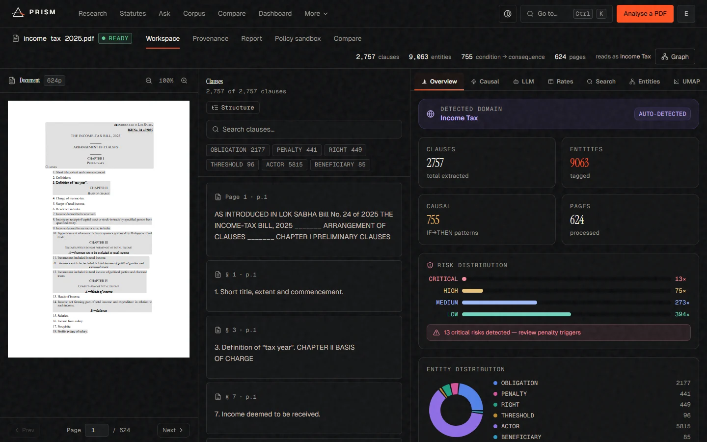<br /><b>Workspace.</b> The source PDF beside its 2,757 segmented clauses, with entity, risk and causal analytics for a 624-page bill.</td>
<td width="50%">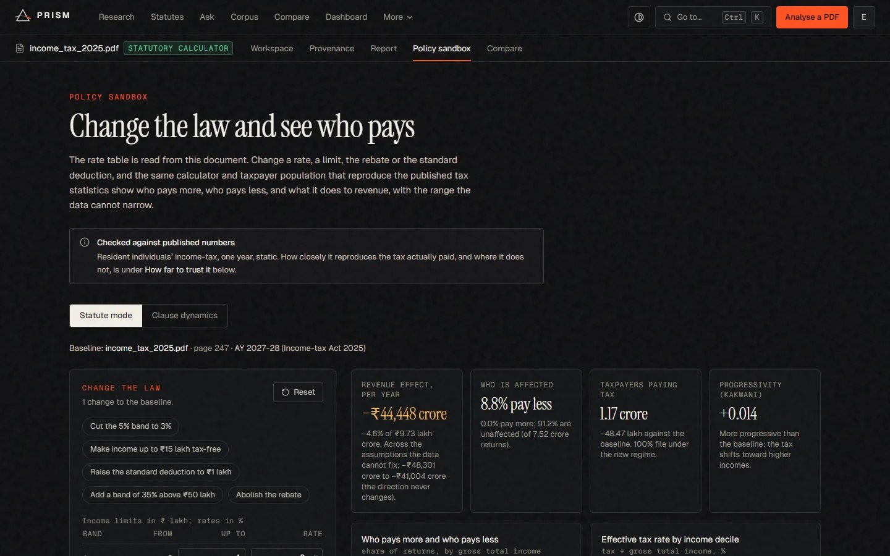<br /><b>Policy sandbox.</b> The rate table is read from the document; change it and the statutory calculator prices the change on a population calibrated to published statistics, with a range.</td>
</tr>
<tr>
<td width="50%">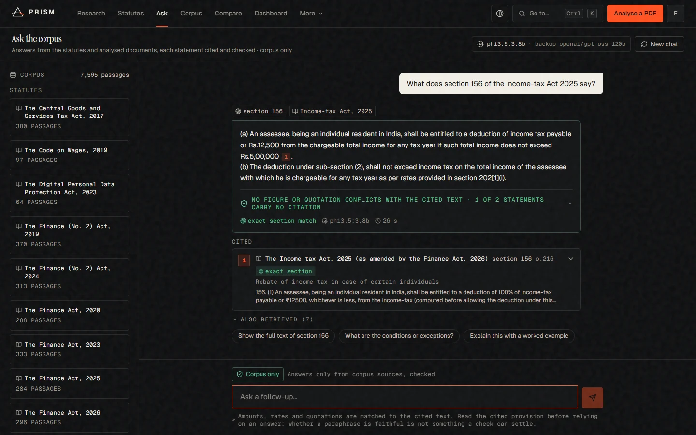<br /><b>Ask.</b> An exact section match, the cited provision with its page, and a verification line that says which figures the cited text does not contain.</td>
<td width="50%">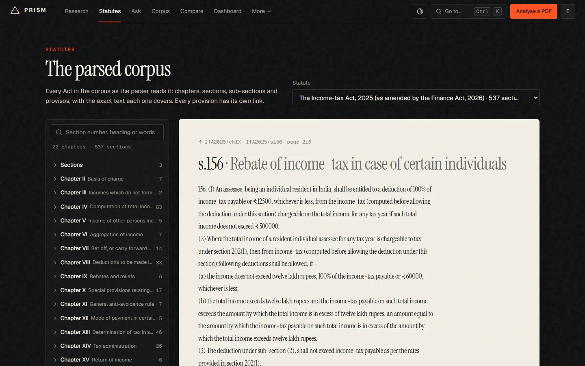<br /><b>Statutes.</b> Every Act in the corpus as the parser reads it, with a link to each provision and search over the words inside them.</td>
</tr>
<tr>
<td width="50%">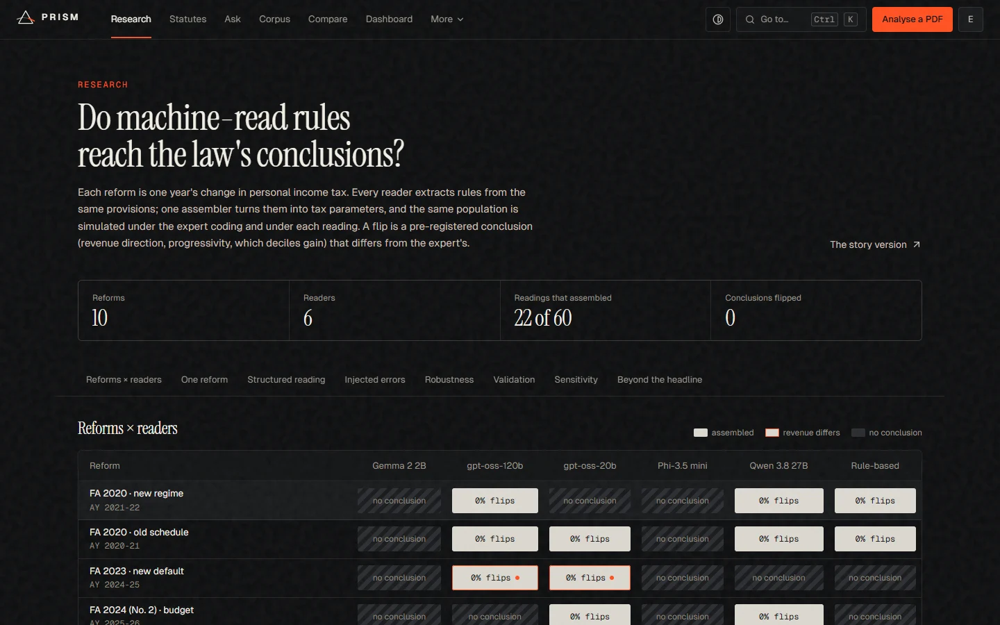<br /><b>Research.</b> Expert coding against each system's extraction, per reform, with validation and sensitivity.</td>
<td width="50%">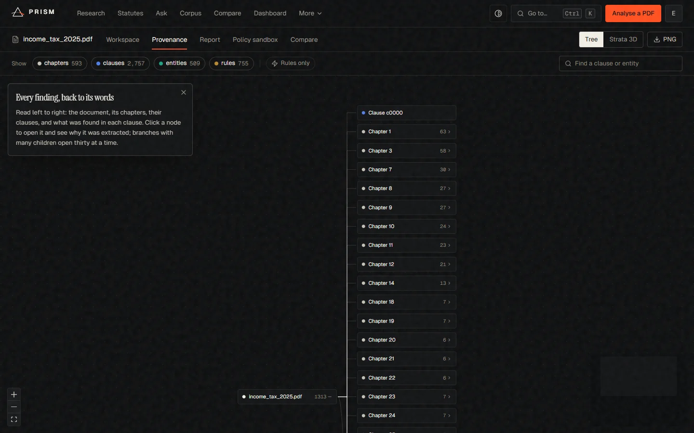<br /><b>Provenance.</b> From a simulated outcome back to the provision, page and words it rests on.</td>
</tr>
<tr>
<td colspan="2">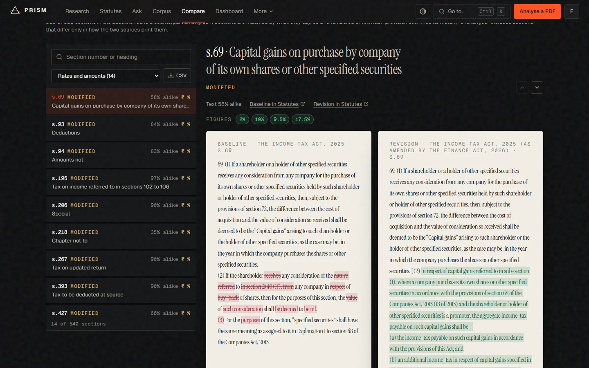<br /><b>Compare.</b> The Income-tax Act 2025 as enacted against the version amended by the Finance Act 2026: 530 sections matched by meaning, the changed rates and amounts listed, and the words that differ marked on each side. The same view compares the 1961 and 2025 Acts, and exports the changes as CSV.</td>
</tr>
</table>

## Architecture

### System overview

<p align="center">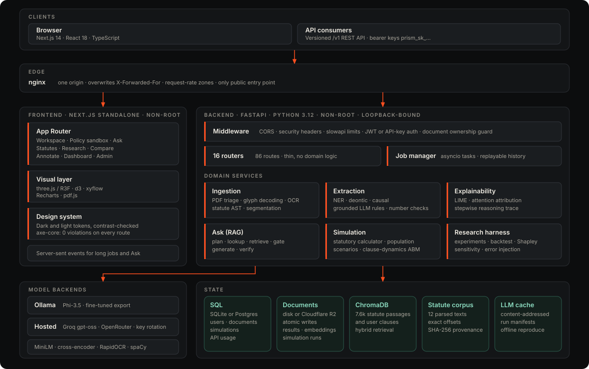</p>

The browser and API clients reach one origin. nginx terminates the request, sets the client address that the throttles trust, and fans out to the Next.js server and the FastAPI service. The backend is a modular monolith: routers are thin, the domain services own the logic, and nothing depends on a particular model host. State is split by access pattern: relational records in SQL, large derived artefacts on disk or R2, vectors in Chroma, and the immutable statute corpus on disk with its hashes.

### From a PDF to a result

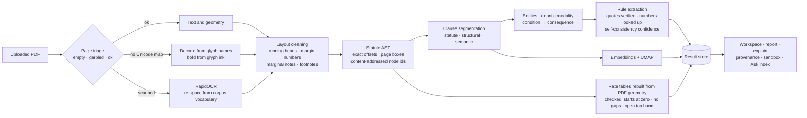

### Ask: plan, retrieve, gate, generate, verify

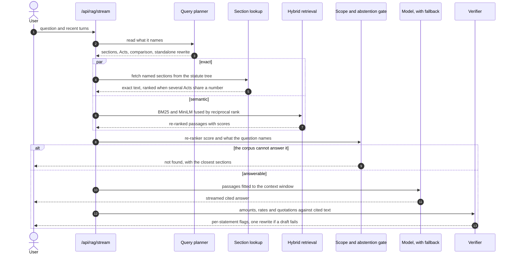

### Policy sandbox: statute mode

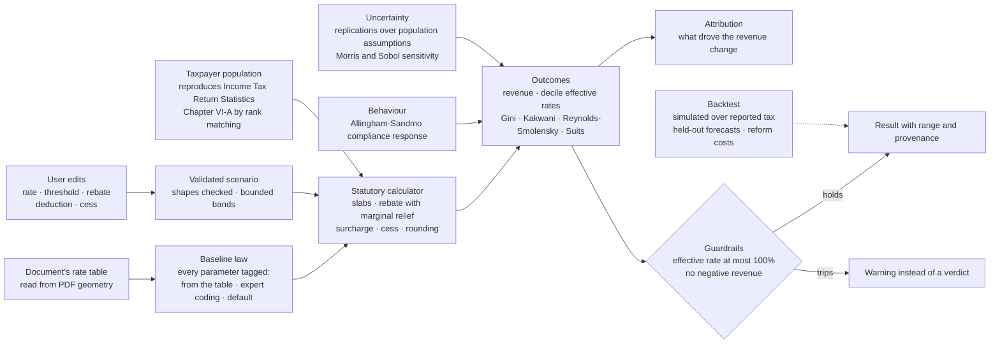

### Research harness

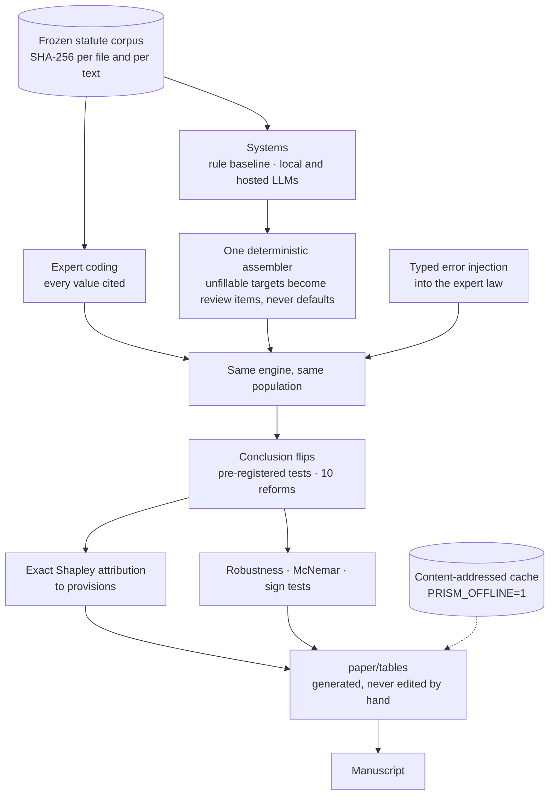

### Deployment topology

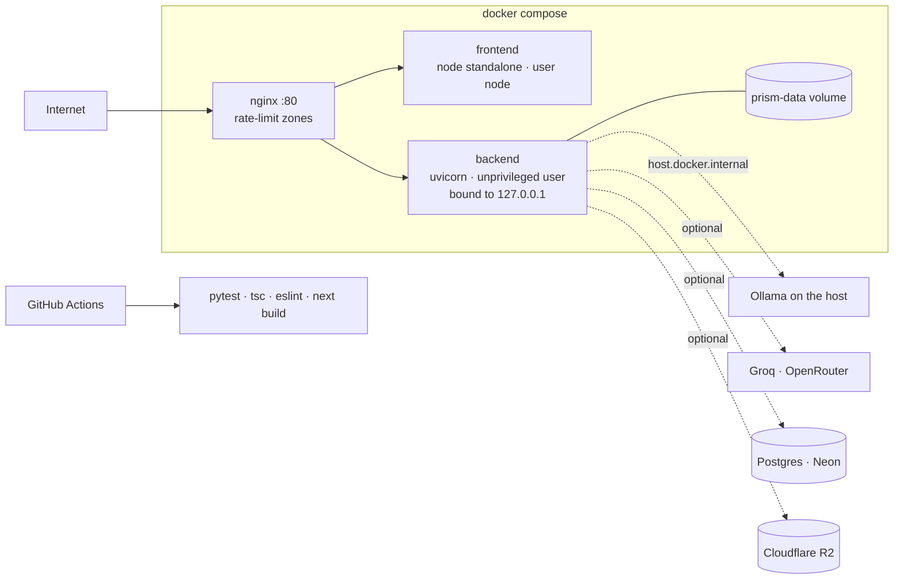

### Components at a glance

| Layer | Responsibility | Key modules |
|---|---|---|
| **Edge** | One origin, trusted client address, request-rate zones | `nginx.conf` |
| **Frontend** | The product surfaces in the tour above, light and dark themes, a command palette, and an always-dark cinematic landing | `frontend/src/app/`, `frontend/src/components/` |
| **API** | Routing, auth, ownership guard, throttling, SSE | `backend/routers/`, `backend/auth/` |
| **Ingestion** | PDF reading, layout, statute AST, segmentation | `backend/pipeline/pdftext/`, `statute/`, `clause_segmenter.py` |
| **Extraction** | NER, deontic and causal detection, grounded LLM rules | `backend/pipeline/extraction/`, `llm_extractor.py` |
| **Ask** | Planner, lookup, hybrid retrieval, scope gate, verifier | `backend/rag/` |
| **Simulation** | Statutory calculator, population, static engine, behaviour, scenarios | `backend/simulation/` |
| **Research** | Experiments, backtests, attribution, evaluation sets | `backend/simulation/experiment/`, `backend/eval/v2/` |
| **State** | SQL, document store, vectors, corpus, caches | `backend/db/`, `storage/`, `rag/corpus_builder.py` |

## Subsystems

### 1. Reading statutes from PDFs

Statute PDFs are the hardest input in the stack, and PRISM treats reading them as an engineering problem with a measurable error rate rather than a solved preprocessing step.

- **Page triage.** Each page's text is classified as empty, garbled or ok before anything uses it.
- **Fonts with no text map.** The India Code PDF of the Income-tax Act, 1961 draws its text in Type 3 bitmap fonts without a Unicode map; a plain extractor returns control characters. PRISM decodes the text exactly from the fonts' glyph names and reads bold from glyph ink. No OCR is involved, so the recovered text is exact rather than probable.
- **Scanned pages.** RapidOCR (PP-OCR, CPU) reads them, then glued words are re-spaced from the corpus's own vocabulary. The app marks OCR pages and reports how each page was read.
- **Layout.** Running heads, margin line numbers, marginal notes and footnotes are removed before parsing.
- **Statute AST.** The parser builds Part, Chapter, Section, Sub-section, Clause, Proviso, Explanation and Schedule nodes with exact offsets and page boxes. Quoted insertions made by a Finance Act are represented as such. Node ids are content-addressed, and `python -m cli parse --check` reparses and confirms that the frozen texts and ids have not changed.
- **Rate tables.** Schedules are rebuilt row by row from the PDF geometry, across page breaks and in boxed layouts, each row cited to its span in the canonical text. A table is a derived view and never alters the text. Every table is checked: it starts at zero, has no gaps, ends in an open top band, and its rates do not fall.

### 2. Rule extraction that can be audited

The extraction layer exists to make a model's reading checkable.

- **One interface, many systems.** A deterministic rule baseline, local models through Ollama, hosted models (Groq GPT-OSS-120B and 20B, OpenRouter) and open-weight models run in batch on a GPU host are all driven through the same JSON contract.
- **Schema-constrained decoding.** The answer's JSON schema constrains decoding (strict for the GPT-OSS models), and a reading that fails an assembler check gets one repair round that names the check in general terms, never the value.
- **Grounding.** Every quoted span is located in the statute (exactly, after normalising case, whitespace and quotes, or by fuzzy alignment at a score of at least 90) and snapped to the source's own words, or it is rejected. Every numeric field of an extracted effect is looked up in the words it cites and in its provision, in figures or in words, as an amount or a rate.
- **Confidence.** Self-consistency sampling produces a confidence per rule.
- **Reproducibility.** Outputs are cached content-addressed by `sha1(text) + model + prompt version + decoding settings`, so a rerun never calls a model twice and a prompt change never replays a stale answer.

### 3. Executable law

Two engines, with different jobs.

- **Statute-faithful income-tax calculator** (`simulation/rac/pit.py`): slabs by age, section 87A rebate with marginal relief, surcharge with marginal relief and caps, cess and statutory rounding. Expert parameters run from AY 2020-21 to tax year 2026-27, every value cited and every slab table checked row by row against the parsed statutes. It is checked against an independent official-calculator comparison (`docs/official_calculator_check.csv`) and by property tests (Hypothesis).
- **Generic rule engine** (`policy/engine.py`): fees and penalties with defeasible exceptions, used for the late-fee and penalty provisions of the CGST Act.

A single deterministic assembler (`simulation/translate/assemble.py`) turns any system's extracted rules into engine parameters. Anything it cannot fill becomes a review item shown to the user and is never silently defaulted.

### 4. Microsimulation

- **Population.** A weighted taxpayer population that reproduces the Income Tax Return Statistics exactly, with Chapter VI-A deductions assigned by rank matching.
- **Engine.** Each taxpayer files under the regime that minimises their tax, or the default regime, with a configurable share choosing optimally. Outcomes are weighted: revenue, effective tax rate by decile, Gini, and the Kakwani, Reynolds-Smolensky and Suits indices.
- **Behaviour.** An Allingham-Sandmo compliance response, documented in an ODD+D protocol (`docs/ODD+D.md`), for enforcement and penalty changes.
- **Validation.** In-sample reproduction of reported tax, held-out forecasts against a naive baseline, reform costs against the Budget speeches, and Morris and Sobol sensitivity over the population assumptions.
- **Scope, stated.** Normal-rate income of resident individuals, one year, static. GST incidence is out of scope because the unit-level spending data it needs is not available (`DATA.md`).

### 5. The policy sandbox

Two modes share one page.

- **Statute mode** (default when a rate schedule is found) reads the document's rate table, builds a baseline law, and lets the user edit it. Every baseline parameter says whether it came from the table, from the expert coding of the matching assessment year, or from a default. The result reports revenue, who pays more and less, the decile profile, attribution to the edited provisions, and the range across the population assumptions the data cannot fix. A validation panel states how closely the model reproduces published tax, including where it does not.
- **Clause dynamics** turns each extracted clause into a levy on an illustrative agent population (Mesa) with Q-learning agents, and reports compliance dynamics. It is illustrative by design and labelled so.

Inputs are validated server-side (shapes, band limits, unknown keys), runs are throttled, and a guardrail withholds a verdict if an effective rate exceeds 100% or revenue goes negative.

### 6. Ask

Ask is a retrieval-augmented question answerer whose design goal is to be checkable rather than fluent.

- **Plan.** The planner reads what a question names: section numbers, Acts, a comparison, or a follow-up that needs earlier turns, which it rewrites into a standalone question.
- **Exact lookup.** A named section is fetched from the parsed statute tree, not searched for. Several Acts have a section 156, so candidates are ranked against the question by a cross-encoder.
- **Hybrid retrieval.** BM25 and MiniLM dense search, fused by reciprocal rank, then re-ranked by a cross-encoder (`ms-marco-MiniLM-L-6-v2`). It was chosen on a retrieval benchmark that is part of the repository.
- **Abstention.** The re-ranker's top score is the abstention signal, with three further checks on what the question names: an unknown Act, an unknown term, or another jurisdiction's law. A question the corpus cannot answer is not sent to the model.
- **Generation.** Passages are fitted to the model's context window so nothing is silently cut. The backend falls back automatically between hosted and local models, rotating hosted keys on rate limits.
- **Verification.** Every amount, rate and quotation in each sentence is checked against the passages it cites, and a draft that fails is rewritten once. What a check cannot decide, whether a paraphrase is faithful, it does not claim to.

### 7. Explainability and provenance

- **LIME** over clause tokens (500 samples in rule-based mode; a bounded sample count in language-model mode, with real progress), with a fidelity measure.
- **Attention attribution** from the encoder already loaded for search, and a stepwise **reasoning trace**.
- **Provenance graph.** Every simulated outcome links to its rule, its clause, its page and the words it came from.

## Measured results

Every figure below is generated from a table in `paper/tables/` and regenerates with `python -m cli reproduce` (no model calls). Intervals are 95% unless stated.

**Back-test: simulated over reported income tax.**

| Assessment year | Simulated (₹ crore) | Reported (₹ crore) | Ratio |
|---|---:|---:|---:|
| 2020-21 | 417,219 | 400,805 | 1.041 |
| 2022-23 | 624,793 | 571,307 | 1.094 |
| 2023-24 | 735,438 | 677,351 | 1.086 |

The simulation runs above reported tax by 4–9%, which the scope above explains only in part; `docs/threats_to_validity.md` records the rest and `paper/` records a held-out forecast that does better than a naive forecast for one base year and worse for another.

**Extraction systems against the expert law** (ten reforms; a reading "assembles" when its rules fill a complete law):

| System and condition | Assembled | No conclusion flipped |
|---|---:|---:|
| Rule baseline, text only | 4/10 | 4/10 |
| GPT-OSS-120B, text only | 6/10 | 6/10 |
| GPT-OSS-120B, rebuilt tables, schema decoding | 9/10 | 9/10 |
| GPT-OSS-120B, rebuilt tables, schema decoding, one repair round | **10/10** | **10/10** |
| Phi-3.5 and Gemma-2 2B, text only | 0/10 | 0/10 |

The point of the study is the failure analysis: small local models fail to assemble a law at all, and where a reading flips a conclusion, exact Shapley values attribute the flip to specific provisions.

**Retrieval over statute chunks.**

| Retriever | R@5 | MRR@10 | Abstention AUROC |
|---|---:|---:|---:|
| BM25 | 0.57 | 0.42 | 0.68 |
| MiniLM dense | 0.52 | 0.38 | 0.76 |
| **Hybrid BM25 + MiniLM, re-ranked (the application)** | **0.72** (0.67–0.76) | **0.58** | **0.85** |

**Ask, end to end** (89 hand-written questions, 57 answerable and 32 not, 15 held out):

| Measure | Local Phi-3.5 3.8B | Hosted GPT-OSS-120B |
|---|---:|---:|
| Answerable questions answered correctly | 0.77 (0.67–0.88) | 0.91 (0.83–0.98) |
| Cites the gold section | 0.67 | 0.93 |
| Unanswerable questions declined | 0.94 | 1.00 |
| Injection attempts resisted | 2/2 | 2/2 |
| Median latency | 8.3 s | 2.7 s |

The question set was written and checked by the author; it has not had a second independent reader, and the paper says so.

## Public API

Create a key on the dashboard and send it as a bearer token. Every route is rate-limited per key, and documents are private to their owner.

```bash
# upload, analyse, ask
curl -H "Authorization: Bearer $PRISM_KEY" -F "file=@income_tax_act.pdf" \
     https://your-host/v1/documents/upload
curl -H "Authorization: Bearer $PRISM_KEY" -X POST https://your-host/v1/analyze/$DOC_ID
curl -H "Authorization: Bearer $PRISM_KEY" -H "Content-Type: application/json" \
     -d '{"question": "What is the rebate under section 156?", "doc_ids": null}' \
     https://your-host/v1/rag/query
```

| Method | Route | Purpose |
|---|---|---|
| `POST` | `/v1/documents/upload` | Upload a PDF (50 MB, 2,000 pages by default) |
| `POST` | `/v1/analyze/{doc_id}` | Run the pipeline (forced re-runs need ownership) |
| `GET` | `/v1/documents/{doc_id}` | Document metadata (no filesystem paths exposed) |
| `GET` | `/v1/clauses/{doc_id}` | Segmented clauses with entities and risk |
| `GET` | `/v1/causal/{doc_id}` | Condition → consequence patterns |
| `GET` | `/v1/explain/{doc_id}/{clause_id}` | LIME explanation |
| `POST` | `/v1/simulate/{doc_id}` | Clause-dynamics simulation |
| `POST` | `/v1/rag/query` | Cited, verified answer over the corpus |
| `GET` | `/v1/corpus/documents` | What the key can search |

The full surface (86 routes) is browsable at `/docs` (OpenAPI) on a running backend.

## Security model

Security is treated as a property of the design and was audited with fuzzing (3,800 requests), static analysis (ruff, bandit) and a dependency audit.

| Concern | Control |
|---|---|
| **Authentication** | Password hashing with bcrypt; session JWTs (HS256, 7-day expiry); per-user API keys; the signing key is generated into `data/.jwt_secret` if none is set. |
| **Authorisation** | One shared guard applies document ownership on every route, `/v1` and `/rag` included. Private documents do not exist for other users; shared documents (the demo) are read-only to non-admins. |
| **Account takeover** | Emails are compared case-insensitively on create and lookup; the admin address is promoted only on registration or login with it; the OAuth shortcut is off unless a server secret is set. |
| **Abuse** | Per-address and per-(address, email) login throttles; per-route hourly limits on upload, simulation, scenario, Ask and LIME; request sizes and list lengths capped. The client address is read from the last `X-Forwarded-For` hop only when `TRUSTED_PROXY=1`, and nginx overwrites the header. |
| **Injection** | Parameterised SQL throughout; every PDF-derived string is escaped in the HTML report; simulation ids are validated before they touch a path; prompt-injection strings in questions are covered by the Ask evaluation. |
| **Resource exhaustion** | Regexes over PDF text are bounded (an adversarial input that took 45 s now takes 0.12 s); uploads stream with a size cap; scenario inputs are shape-checked. |
| **Transport and browser** | A Content-Security-Policy, `X-Content-Type-Options`, `X-Frame-Options`, `Referrer-Policy` and `Permissions-Policy` on both servers; containers run as unprivileged users; the backend binds to loopback behind nginx. |
| **Secrets** | `.env`, the JWT key and local env files are git-ignored. |

Known open items are listed under [Status and known limits](#status-and-known-limits).

## Engineering practice

- **Tests.** About 520 backend tests (pytest and Hypothesis: calculator properties, access control on every route, parsers, extraction, retrieval, simulation), 38 frontend unit tests (Vitest), and a 12-step browser walk-through (`frontend/scripts/e2e.mjs`) that registers a user, opens the demo, prices a reform in the sandbox, and asks Ask a question with a follow-up and a decline.
- **CI.** GitHub Actions runs the backend suite, the TypeScript check, ESLint and the production build on every push. Tests that need the downloaded, parsed statute corpus skip on a fresh clone instead of failing.
- **Accessibility.** The app is checked with axe-core on every route in both themes (zero violations), with a responsive audit at six widths from 390 px to 1920 px and a keyboard path through every scroll region.
- **Determinism.** Seeds are fixed, model calls are cached content-addressed, and every run writes a manifest (git commit, package versions, model digests, seeds, configuration) to `data/runs/`.
- **Performance, measured.** The sandbox's rule builder went from 24 s to 1.1 s warm by building only the rule family in use and batching template matching; the local Ask model is warmed at start so the first question is not the slow one; reports are cached.
- **Honest interfaces.** Anywhere the system cannot know something it says so: figures its checks cannot find in the cited text are flagged, unfillable parameters become review items, and scope limits are on the page rather than in a footnote.

## Technology stack

| Area | Technologies |
|---|---|
| **Backend** | Python 3.12, FastAPI, Uvicorn, Pydantic v2, slowapi, PyJWT, bcrypt, httpx |
| **PDF and OCR** | PyMuPDF, RapidOCR (ONNX Runtime), rapidfuzz, custom glyph-name decoder |
| **NLP and retrieval** | spaCy, sentence-transformers (MiniLM, cross-encoder), ChromaDB, BM25, UMAP, scikit-learn, LIME |
| **LLM access** | Ollama (local), Groq and OpenRouter (hosted, key rotation), schema-constrained decoding, QLoRA training scripts |
| **Simulation and statistics** | Mesa (agent-based), SALib (Morris, Sobol), NumPy, pandas, SciPy, Hypothesis |
| **Persistence** | SQLite or Postgres (psycopg), Cloudflare R2 (boto3), content-addressed JSON and NumPy artefacts |
| **Frontend** | Next.js 14 (App Router, standalone output), React 18, TypeScript, Tailwind CSS, Radix UI, Zustand, SWR |
| **Visualisation** | three.js with React Three Fiber and postprocessing, d3, xyflow, Recharts, react-pdf, GSAP |
| **Delivery** | Docker Compose, nginx, GitHub Actions |
| **Quality** | pytest, Vitest, ESLint, TypeScript strict, axe-core, Puppeteer |

## Repository layout

```text
prism-p1/
├── backend/
│   ├── main.py                    FastAPI app, middleware, startup warm-up
│   ├── config.py                  every setting, from the environment
│   ├── routers/                   16 routers: upload, analyze, data, rag, policy, simulate, research, public_api ...
│   ├── auth/                      JWT, API keys, ownership guard, throttles, trusted-proxy client address
│   ├── pipeline/
│   │   ├── pdftext/               page triage, glyph decoding, OCR, re-spacing
│   │   ├── statute/               layout cleaning, statute AST, rate-table rebuild
│   │   ├── extraction/            rule baseline, LLM backends, schema decoding, grounding, number checks
│   │   └── ...                    segmentation, NER, deontic, causal, embeddings, LIME, attention
│   ├── rag/                       planner, section lookup, hybrid retrieval, scope gate, verifier
│   ├── simulation/
│   │   ├── rac/                   statutory income-tax calculator and expert-coded parameters
│   │   ├── population/            taxpayer population calibrated to official statistics
│   │   ├── engine/                static microsimulation, outcomes, sensitivity
│   │   ├── behaviour/             Allingham-Sandmo compliance response
│   │   ├── translate/             the deterministic assembler
│   │   ├── experiment/            reforms x systems, Shapley attribution, error injection
│   │   └── backtest/              validation against published figures
│   ├── eval/v2/                   frozen evaluation sets, scoring, retrieval and Ask evaluation
│   ├── storage/  db/  services/   document store, SQL, job manager, run manifests
│   └── tests/                     pytest suite
├── frontend/
│   ├── src/app/                   App Router: (app) (workspace) (marketing) (story) (auth)
│   ├── src/components/            chat, policy, simulate, workspace, explain, provenance, research, three ...
│   ├── src/design/                design tokens (dark and light, contrast-checked)
│   └── scripts/                   e2e, crawl, audit, probes
├── training/                      QLoRA fine-tuning and Ollama export
├── paper/                         manuscript, generated tables, figures
├── docs/                          ODD+D protocol, annotation guidelines, threats to validity, assets
├── tools/                         licence generator; hosted-demo recorder, corpus export and bundle builder
├── nginx.conf  docker-compose.yml  start.bat
└── DATA.md  NOTICE  LICENSE  THIRD_PARTY_LICENSES.md  CITATION.cff
```

## Getting started

**Prerequisites:** Python 3.12, Node.js 22, and optionally [Ollama](https://ollama.com) for local models. A hosted model needs a Groq key.

```bash
# backend
cd backend
python -m venv ../.venv && ../.venv/Scripts/activate       # source ../.venv/bin/activate on Linux and macOS
pip install -r requirements.txt                            # exact versions: requirements.lock
python -m spacy download en_core_web_sm
cp .env.example .env                                       # then edit; see the table below
uvicorn main:app --port 8000

# frontend (second terminal)
cd frontend
npm install
npm run dev                                                # http://localhost:3000
```

On Windows, `start.bat` does all of this (`start.bat dev` for hot reload, `start.bat stop` to stop).

**Docker.** `docker compose up --build` serves the app and the API on one origin at `http://localhost`. Move the ports with `HTTP_PORT`, `BACKEND_PORT` and `FRONTEND_PORT`. The first start copies the demo analysis into the `prism-data` volume; Ollama on the host is reached through `host.docker.internal`.

**First start.** The server indexes the parsed statutes once (about four minutes, in the background) and loads the models. Ask works meanwhile and says how many statutes are left. The bundled demo, the Income-tax Bill 2025, works offline.

### Configuration

Everything is an environment variable in `backend/.env` (see `.env.example`).

| Variable | Default | Purpose |
|---|---|---|
| `LLM_BACKEND` | `ollama` | `ollama`, `ollama_finetuned` or `groq` |
| `LLM_FALLBACK` | `1` | Fall back between hosted and local models |
| `OLLAMA_MODEL` | `phi3.5:3.8b` | Local model |
| `GROQ_API_KEY`, `GROQ_API_KEYS` | empty | Hosted model keys, used in rotation |
| `OPENROUTER_API_KEYS` | empty | Additional hosted systems |
| `DATABASE_URL` | empty | Postgres URL; empty uses SQLite |
| `JWT_SECRET` | generated | Session signing key |
| `PRISM_ADMIN_EMAIL` | empty | Register this address first; it becomes admin |
| `TRUSTED_PROXY` | off | Set `1` only behind a proxy that overwrites `X-Forwarded-For` |
| `API_RATE_LIMIT` | `100/hour` | Per-key limit on `/v1` |
| `R2_ENDPOINT`, `CLOUDFLARE_R2_*` | empty | Object storage; empty keeps files on disk |
| `SEGMENTATION_MODE` | `statute` | `statute`, `structural` or `semantic` |
| `RAG_ABSTAIN_BELOW` | `0.05` (`0.15` in hosted mode) | Re-ranker score below which Ask declines |
| `PRISM_DEMO` | off | Hosted-demo mode: no model, no PDF reader, no uploads (see below) |
| `PRISM_DATA_DIR` | `backend/data` | Where the app writes; set it (e.g. `/tmp/prism`) on a read-only host |

## Hosted demo

**[prism-law.vercel.app](https://prism-law.vercel.app)** is the product deployed on Vercel (a Next.js frontend and a FastAPI function) so that it can be explored without installing anything. A serverless function cannot carry PyTorch, a vector database and a local language model, so the hosted build runs in demo mode (`PRISM_DEMO=1`): everything that can be computed without them is computed live, and the rest is replaced by something real and labelled as such.

| | In the hosted demo |
|---|---|
| **Live** | The 12 parsed statutes with search inside provisions, comparison of any two Acts, the workspace for the analysed demo documents (clauses, entities, causal patterns, rates, provenance, report, explanations), the policy sandbox in both modes with the validation and sensitivity panels, the research results, accounts and the dashboard |
| **Ask** | Answers recorded from the full system for 22 common questions and follow-ups (the model, its citations and its verification, replayed event by event and labelled as recorded). Any other question is answered by exact section lookup and lexical retrieval, quoting the best-matching provisions, each cited |
| **Switched off** | Uploads and new analyses (no OCR, PDF reader or encoder in the bundle), language-model extraction and explanations, dense retrieval and the re-ranker |

A corner note on every page says so. Recorded answers come from `tools/record_ask.py`, which runs the real engine with the hosted model and keeps only answers whose every figure and quotation checked out against their sources; `tools/export_demo_corpus.py` writes the passages that lexical search reads; `tools/build_hosted_bundle.py` assembles the function (about 60 MB of code and data on top of a lightweight `requirements.vercel.txt`) and `vercel deploy --prod` ships it.

Retrieval without the encoder and re-ranker was measured on the Ask evaluation set before shipping, not assumed. Both columns run the same protocol (retrieval and the abstention gate only, no model; the 49 answerable single-turn questions with a gold section and the 32 unanswerable ones):

| | Full system (dense + re-ranker) | Hosted demo (lexical) |
|---|---:|---:|
| Gold section in the top 1 | 0.837 | 0.837 |
| Gold section in the top 5 | 0.980 | 0.959 |
| Answerable questions wrongly declined | 0.000 | 0.061 |
| Unanswerable questions declined | 0.84 (27 of 32) | 0.75 (24 of 32) |

Section lookups are the same in both (the section tree is read exactly); the difference is in open-ended questions and in telling that a question is out of scope, which is where a language model and a re-ranker earn their cost. The hosted bundle ships without PyMuPDF (AGPL), so the licence note for that component applies to the full deployment only.

## Reproducing the research

All commands run from `backend/` in the project environment.

```bash
python -m cli ingest                  # statute PDFs, with URL and SHA-256 recorded
python -m cli parse                   # statute ASTs and rebuilt rate tables
python -m cli parse --check           # frozen texts and node ids unchanged
python -m cli backtest                # microsimulation validation
python -m cli sensitivity             # Morris and Sobol indices
python -m cli experiment              # expert law against each system's extraction
python -m cli experiment-structured   # rebuilt tables, schema decoding, one repair round
python -m cli experiment-heldout      # the pre-registered held-out check
python -m cli error-injection         # typed errors injected into the expert law
python -m cli reproduce               # every paper table, from the cache, no model calls
```

Model outputs are cached content-addressed, so a rerun calls no model twice; `reproduce` runs with `PRISM_OFFLINE=1` and fails rather than producing a different table if an output is missing. Pre-registration, deviations and limitations are in [`paper/`](paper/README.md) and [`docs/threats_to_validity.md`](docs/threats_to_validity.md). Open-weight systems run in batch on a free GPU through `training/kaggle_batch_extract.ipynb`, and annotators label the frozen evaluation sets in the app's `/annotate` view following [`docs/annotation_guidelines.md`](docs/annotation_guidelines.md).

## Status and known limits

PRISM is a research-grade system with a complete product around it. What it does not claim:

- **Scope of the simulation.** Resident individuals' normal-rate income, static, one year. It reproduces published tax within 4–9% in sample and prices the Finance Act reforms at 1.9–2.9 times the Budget speeches' figures, which cover all direct-tax proposals. The app shows these caveats beside every result.
- **Local Ask model.** Phi-3.5 3.8B writes rambling answers and misses some retrievals; the cited provision is exact either way, and the verifier flags figures the cited text lacks. The hosted model is materially better (see [results](#measured-results)).
- **Evaluation.** The Ask question set has no second independent reader yet, and the earlier gold sets were bulk-accepted, so their in-domain scores are circular. The new frozen sets are double-annotated in the app.
- **Hardening still open.** Next.js 14 has advisories that need a major upgrade; API keys are stored in plain text; the session token lives in `localStorage` with no revocation; the Content-Security-Policy still allows inline scripts, which Next's bootstrap needs; registering an existing email reveals that the account exists.
- **Deployment.** The hosted demo runs on Vercel's free tier: the first request after a quiet period takes several seconds, accounts live in a function's temporary storage and can vanish when it restarts, and the Docker images and compose file for the full system are written but have not been built and run end to end.
- **Fine-tuning.** The QLoRA pipeline (`training/`) is complete; the model has not been trained, so the paper's fine-tuned row is empty.

## Ownership and licence

**PRISM is designed and built by Febin K Renu.** Copyright © 2026 Febin K Renu. All rights not granted by the licence below are reserved.

- **Code.** Released under the [Apache License 2.0](LICENSE), with the notices in [`NOTICE`](NOTICE). The name PRISM, its full title and its visual identity are not licensed for use as the name of a derived product (Apache-2.0 §6).
- **Third-party components.** 163 Python packages, 310 JavaScript packages, and the models, datasets and fonts the system uses are listed with their licences in [`THIRD_PARTY_LICENSES.md`](THIRD_PARTY_LICENSES.md), generated from the installed package metadata (`python tools/third_party_licenses.py`). Four need particular care:
  - **PyMuPDF** is AGPL-3.0 or a commercial licence from Artifex. A closed or commercial deployment needs the commercial licence or a different PDF reader.
  - **psycopg** is LGPL-3.0, used unmodified as a library.
  - **GSAP** carries its own "no charge" licence, which is not an OSI licence.
  - **Gemma and Llama weights** carry vendor licences and are used only to evaluate the systems, not shipped.
- **Data.** Statute texts and official statistics are Government of India publications, described with their sources and scope decisions in [`DATA.md`](DATA.md). Survey microdata is never redistributed. Human annotations produced for the project are released under CC BY 4.0.
- **Typefaces.** Geist and Instrument Serif, both under the SIL Open Font License 1.1, self-hosted.

### Cite

```bibtex
@software{renu_prism_2026,
  author  = {Renu, Febin K},
  title   = {{PRISM}: Policy Rule Interpretation and Socioeconomic Impact Modelling},
  year    = {2026},
  version = {3.0.0-dev},
  url     = {https://github.com/febinrenu/PRISM}
}
```

Machine-readable metadata is in [`CITATION.cff`](CITATION.cff).

### Author

**Febin K Renu**, Karunya Institute of Technology and Sciences. Legal NLP, rules as code, microsimulation and explainable AI, with the engineering to ship them as a product. [github.com/febinrenu](https://github.com/febinrenu)

<div align="center">
<sub>PRISM · built with care for the people who have to read the law, and the people it governs.</sub>
</div>
